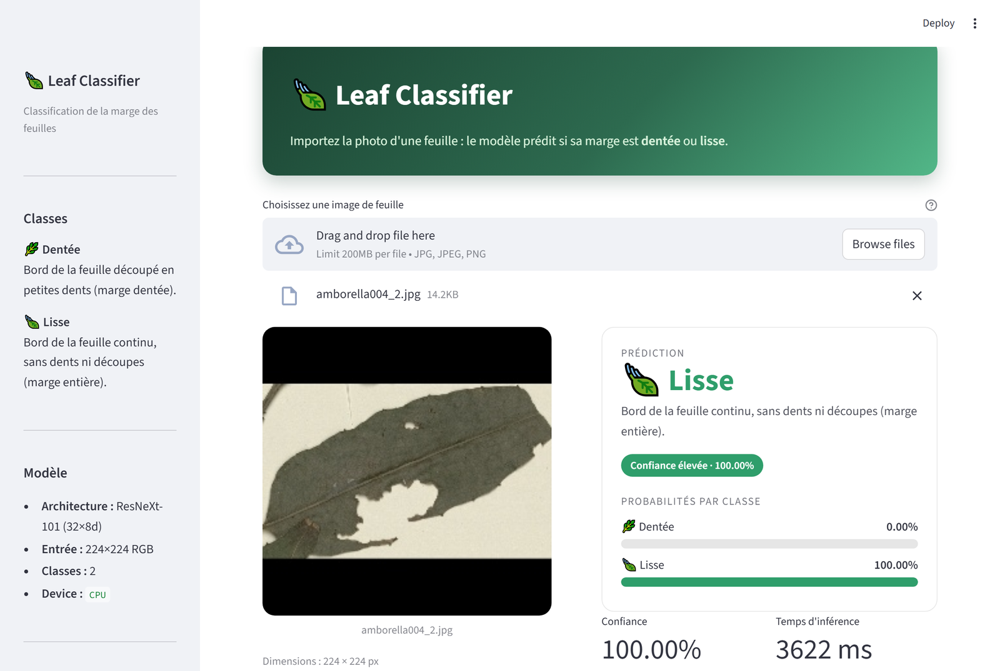
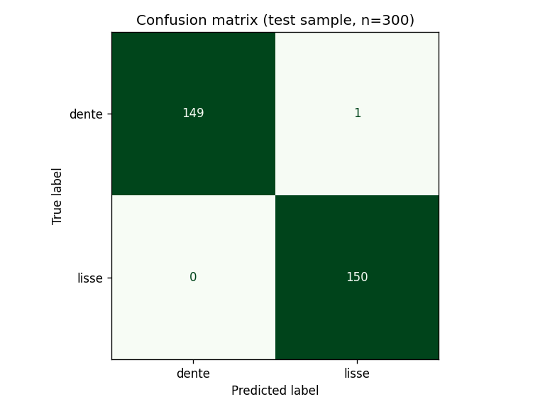
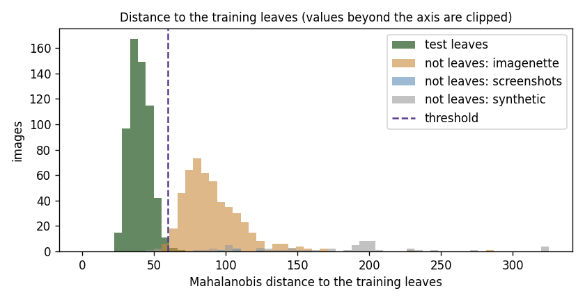

# 🍃 Leaf Classification

[](https://github.com/dihiaganoun/Leaf-Classification/actions/workflows/ci.yml)


[](https://leaf-margin-classifier.streamlit.app)
[](https://huggingface.co/dganoun/leaf-classifier-resnext101)

Classifies a leaf photo by the shape of its margin: **dentée** (toothed edge) or **lisse** (smooth edge).

A **ResNeXt-101 (32×8d)** pretrained on ImageNet is fine-tuned on ~6,500 leaf images, then served through a **Streamlit** web app.

**▶ [Try the live demo](https://leaf-margin-classifier.streamlit.app)**, no installation needed.



## Results

Evaluated on the held-out **test split** (15% of the dataset, 984 images, never seen during training):

| Metric | Score |
|--------|-------|
| Accuracy | **98.68%** |
| F1 | 0.9861 |
| Precision | 0.9935 |
| Recall | 0.9787 |
| Balanced accuracy | 0.9864 |
| Cohen's kappa | 0.9735 |

| Class | Precision | Recall | F1 | Images |
|-------|-----------|--------|----|--------|
| dente | 0.99 | 0.98 | 0.99 | 470 |
| lisse | 0.98 | 0.99 | 0.99 | 514 |

These numbers come from `notebooks/training.ipynb` (Colab, GPU).

### Local check of the published weights

`scripts/evaluate.py` re-runs the published weights on a stratified sample of the test split (150 images per class, CPU):

| Sample | Accuracy | Macro F1 | Errors |
|--------|----------|----------|--------|
| 300 images | 99.67% | 0.9967 | 1 (a toothed leaf predicted smooth) |



The `dente` sample is exactly from the held-out test split. The local copy of the dataset has 15 fewer `lisse` images than the one used for training, so the `lisse` split cannot be rebuilt identically and that half of the sample may include training images. Treat this table as a check that the weights work, and the test-split table above as the real score.

## Rejecting images that are not leaves

A two-class classifier always picks a class: before this check, a screenshot was labelled "dentée" with 93% confidence. The app now refuses such images instead of returning a wrong answer.

**How it works.** The model turns every image into a 2048-value feature vector just before its final layer. `scripts/fit_leaf_detector.py` measures, on 3,000 training leaves, the mean vector of each class and their shared covariance (Ledoit-Wolf shrinkage). A new image is accepted only if its [Mahalanobis distance](https://arxiv.org/abs/1807.03888) to the nearest class mean stays under a threshold. This reuses the classifier's own forward pass, so there is no second model and no extra latency. Nearly uniform images (pixel standard deviation under 5) are rejected as blank before that; the least contrasted leaf in the dataset is at 19.2.

**Calibration.** The threshold is set to accept 99% of 600 validation leaves, then measured on data it never saw:

| Images | Count | Result |
|--------|-------|--------|
| Test leaves | 600 | **99.2% accepted** |
| [Imagenette](https://github.com/fastai/imagenette) photos (dogs, trucks, churches…) | 500 | **98.6% rejected** |
| Screenshots and diagrams | 4 | 100% rejected |
| Synthetic images (solid colours, gradients, noise) | 60 | 95% rejected by distance, 100% with the blank check |



The detector statistics (`ood_stats.npz`, 16 MB) are hosted next to the weights on Hugging Face Hub and downloaded the same way.

## Project structure

```
Leaf-Classification/
├── app/
│   └── streamlit_app.py      # Web interface
├── src/leaf_classifier/
│   ├── config.py             # Classes, image size, model path
│   ├── model.py              # Model building, weight loading, inference
│   ├── ood.py                # Rejection of images that are not leaves
│   └── data.py               # Train/val/test split (same as the notebook)
├── scripts/
│   ├── evaluate.py           # Evaluation on a test sample
│   └── fit_leaf_detector.py  # Fits and calibrates the leaf detector
├── tests/                    # Unit tests (no weights needed)
├── notebooks/
│   └── training.ipynb        # Training and full test evaluation
├── docs/                     # Screenshot, metrics, confusion matrix
├── Dockerfile
├── requirements.txt          # Pinned runtime dependencies
└── requirements-dev.txt      # + evaluation and test tools
```

## Getting started

### 1. Clone

```bash
git clone https://github.com/dihiaganoun/Leaf-Classification.git
cd Leaf-Classification
```

The trained weights (~350 MB) are hosted on [Hugging Face Hub](https://huggingface.co/dganoun/leaf-classifier-resnext101). They are downloaded automatically the first time the model is loaded, then cached.

### 2. Install

```bash
python -m venv .venv
source .venv/bin/activate        # Windows: .venv\Scripts\activate
pip install -r requirements.txt
```

`requirements.txt` also installs the `leaf_classifier` package in editable mode.

### 3. Run the app

```bash
streamlit run app/streamlit_app.py
```

Then open http://localhost:8501.

To use a local copy of the weights instead, put it in `models/resnext101_leaves.pth` or set `LEAF_MODEL_PATH=/path/to/weights.pth`.

### Docker

```bash
docker build -t leaf-classifier .
docker run -p 8501:8501 leaf-classifier
```

The image uses CPU-only PyTorch to stay small and downloads the weights at build time. The live demo runs on Streamlit Community Cloud, which uses `app/requirements.txt` (CPU-only PyTorch).

## Using the model in Python

```python
from PIL import Image
from leaf_classifier import load_model, predict

model = load_model()
print(predict(model, Image.open("leaf.jpg")))
# e.g. {'dente': 0.0003, 'lisse': 0.9997}

# With the check that the image is a leaf
from leaf_classifier.ood import LeafDetector, analyze

result = analyze(model, LeafDetector.load(), Image.open("photo.jpg"))
print(result.is_leaf, result.rejection, result.probs)
# e.g. False 'not_leaf' {...}  -> do not trust probs
```

## Development

```bash
pip install -r requirements-dev.txt
pytest                                   # fast, uses a stub model
python scripts/evaluate.py --data-dir path/to/feuilles_plantes --per-class 150
python scripts/fit_leaf_detector.py --data-dir path/to/feuilles_plantes \
    --ood-dir path/to/imagenette/val --ood-dir path/to/other_non_leaf_images
```

The dataset is not versioned. `--data-dir` must contain one folder per class (`dente/`, `lisse/`).

GitHub Actions runs the tests on every push and pull request.

## Model and training

- **Backbone:** ResNeXt-101 32×8d, ImageNet weights
- **Fine-tuning:** `layer3`, `layer4` and the new `fc` head are trained, earlier layers are frozen
- **Split:** stratified 70% train / 15% validation / 15% test (seed 0)
- **Optimizer:** AdamW, lr 1e-4, `ReduceLROnPlateau` on validation loss
- **Training:** 20 epochs, batch size 32, input 224×224, ImageNet normalization

## Known limitations

Found while reviewing the training notebook. They do not affect the published results above, which were measured on the saved weights, but they matter for retraining:

- **Data augmentation is not applied.** The train and test subsets share one dataset object, and its transform is switched to the evaluation transform right after the train loader is built. Training therefore ran without augmentation.
- **"Best model" is actually the last epoch.** `model.state_dict().copy()` is a shallow copy, so the saved "best" state keeps changing with training. The saved weights are from epoch 20.
- **The AUC printed in the notebook (0.0009) is inverted.** The score used is the `lisse` probability while the positive class is `dente`. The real AUC is about 0.999.
- Accuracy on real-world photos (cluttered backgrounds, different lighting) has not been measured. Because the leaf detector is fitted on the training leaves, such photos may also be rejected as "not a leaf". This is intentional: a refusal is safer than a confident wrong answer.
- The detector was calibrated against everyday photos, screenshots and synthetic images. Plant photos that are not single pressed leaves (flowers, whole plants) were not measured separately.

## License

[MIT](LICENSE)
